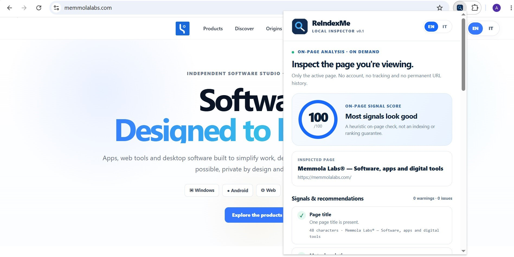
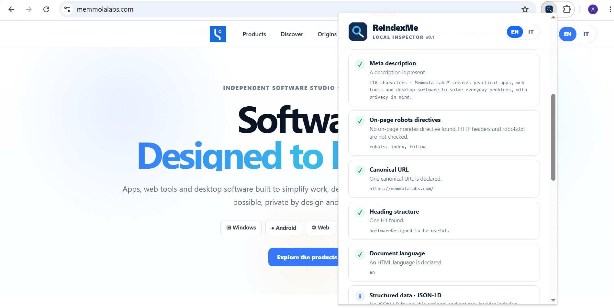
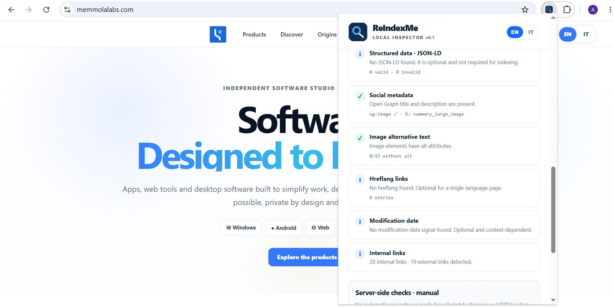
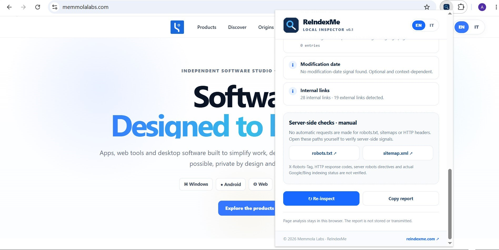
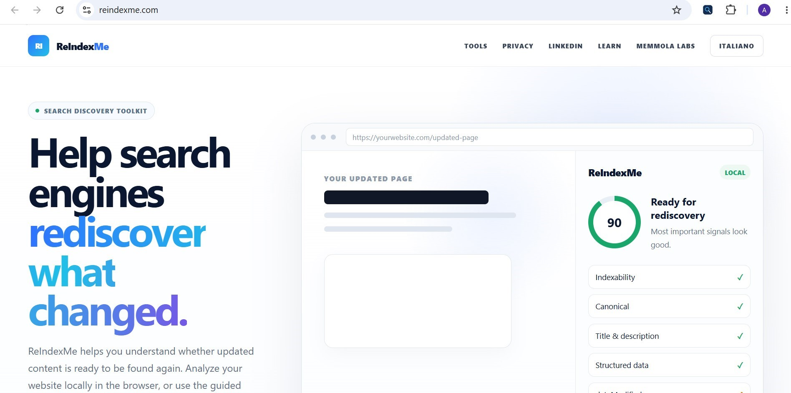
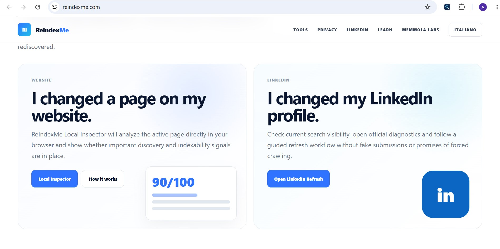
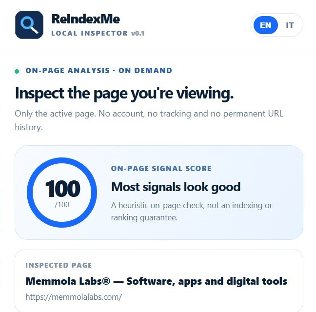
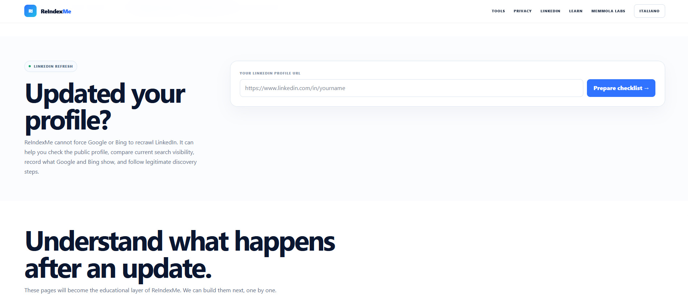
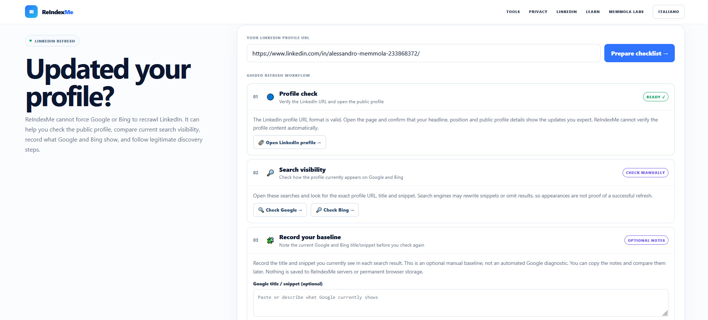
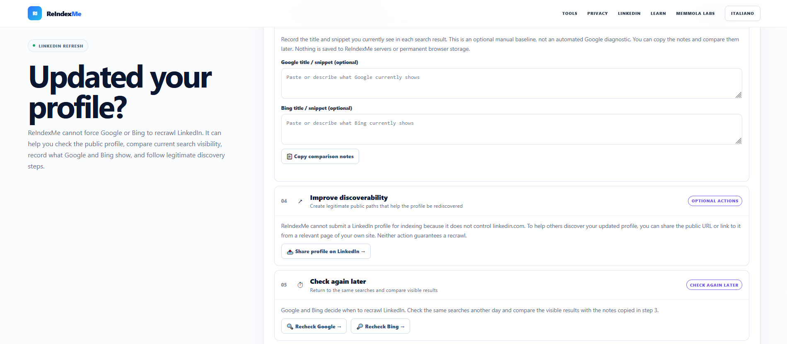

# ReIndexMe

🇮🇹 [Versione italiana disponibile su reindexme.com/it](https://reindexme.com/it/)

**Help search engines rediscover what changed.**

ReIndexMe is a Memmola Labs project focused on helping users understand whether updated online content is ready to be rediscovered by search engines.

The project is built around a simple principle:

**no ReIndexMe account, no domain verification, no permanent website access, and no permanent URL collection.**

ReIndexMe currently includes two main paths:

- **LinkedIn Refresh** — a guided workflow for checking an updated public LinkedIn profile and its current visibility in search engines.
- **ReIndexMe Local Inspector** — a browser extension in development for locally inspecting web pages and identifying signals that may affect crawling, indexability, and rediscovery.

🔗 **[reindexme.com](https://reindexme.com)**

---

## Release

Latest version: [v1.0.0](https://github.com/alessandromemmola/reindexme/releases/tag/v1.0.0)

ReIndexMe is actively maintained and evolving beyond the original LinkedIn-focused release.

---

## Live Service

Website:

https://reindexme.com

Italian version:

https://reindexme.com/it/

Widget Demo:

https://reindexme.com/widget-demo.html

Italian Widget Demo:

https://reindexme.com/it/widget-demo.html

---

## Screenshots Local Inspector

  
  
  
  
  
  


---

## ReIndexMe Local Inspector

**Version:** `0.1.0` · **Status:** Submitted for review to the **Chrome Web Store** and **Microsoft Edge Add-ons** (not yet published).

ReIndexMe Local Inspector is a browser extension for Google Chrome and Microsoft Edge that inspects the **current webpage only when the user requests it**. It helps website owners, developers, and content creators identify on-page signals that may affect search discovery and indexability.

### What it checks

- Page title and meta description, including approximate length guidance.
- On-page robots directives (for example, `noindex` in HTML metadata).
- Canonical URL declarations.
- H1 heading structure and document language.
- JSON-LD structured data presence and syntax.
- Open Graph and other social-sharing metadata.
- Image alternative-text availability.
- Hreflang declarations and modification-date hints.
- Internal and external links.

### How it works

1. Open a regular webpage in Chrome or Edge.
2. Click the ReIndexMe Local Inspector extension icon to inspect the active page.
3. Review the **0–100 on-page signal score** and the `GOOD`, `WARN`, and `INFO` explanations.
4. Use **Copy report** to copy the text results to the clipboard if needed.
5. Open the suggested manual checks separately when you need to investigate server-side signals.

The score is an **indicative on-page diagnostic**, not a search ranking, indexing probability, or guarantee of search-engine visibility.

### Local processing and permissions

Local Inspector v0.1.0 uses the browser permissions **`activeTab`** and **`scripting`**. It accesses the active webpage temporarily after a user action, performs its inspection locally, and does not require:

- A ReIndexMe account or site-ownership verification.
- Persistent access to websites or browsing history.
- Analytics, advertising trackers, or a remote inspection backend.
- Permanent storage of inspected URLs or reports.

The **Copy report** action writes to the system clipboard only when the user requests it. See the [Local Inspector Privacy Policy](https://reindexme.com/local-inspector-privacy.html) for details.

### What it does not verify

The extension does not independently verify server response codes, `X-Robots-Tag` response headers, `robots.txt` restrictions, sitemap availability, or whether Google or Bing has indexed a page. Some of these can be opened for **manual checks**, but they are not included as verified on-page findings.

**Availability:** The v0.1.0 packages were submitted for review in November 2026. Store links will be added here **after approval and publication**. Submission is not an approval or a public release.

**Repository scope:** The existing repository primarily documents and hosts the ReIndexMe website. The Local Inspector extension package is a separate component; its source should not be assumed to be included in this repository until it has actually been committed here. The licensing terms for the website and extension are governed by their respective distributed materials.

---

## Screenshots LinkedIn Refresh

  
  
  

---

## LinkedIn Refresh

Have you updated your LinkedIn profile while Google or Bing still shows older information?

LinkedIn Refresh provides a guided workflow to:

1. Validate the public LinkedIn profile URL
2. Open and verify the updated public profile
3. Check its current visibility on **Google**
4. Check its current visibility on **Bing**
5. Open official Google diagnostic tools
6. Follow legitimate discovery actions that may help the updated profile be rediscovered
7. Recheck search results later

ReIndexMe **does not submit indexing requests for linkedin.com** and does not claim to force Google, Bing, LinkedIn, or any other third party to recrawl a profile.

Search engines independently decide when and how their results are crawled, indexed, and updated.

---

## Privacy by Design

ReIndexMe is designed to require as little additional trust from the user as possible.

The core workflow does not require:

- a ReIndexMe account
- domain ownership verification
- permanent website access
- verification files installed in the domain root
- permanent collection of inspected URLs
- profiling cookies

Local Inspector is designed to inspect the active page locally in the browser when requested by the user.

---

## Repository Structure

```text
reindexme/
├── index.html            # Main ReIndexMe website (English)
├── widget-demo.html      # Widget demo and embed instructions (English)
├── license.html          # License and terms (English)
├── it/
│   ├── index.html        # Main ReIndexMe website (Italian)
│   ├── widget-demo.html  # Widget demo and embed instructions (Italian)
│   └── licenza.html      # License and terms (Italian)
├── sitemap.xml
├── robots.txt
└── README.md
```

> The embeddable widget source code is hosted separately and deployed through [reindexme-widget.vercel.app](https://reindexme-widget.vercel.app).

---

## Embeddable Widget

LinkedIn Refresh is also available as a **free embeddable widget** for personal and commercial websites.

The widget provides a compact version of the LinkedIn Refresh workflow directly inside the host website.

### iFrame

```html
<iframe
  src="https://reindexme-widget.vercel.app/index.html"
  width="480"
  height="420"
  title="ReIndexMe LinkedIn Refresh widget"
  loading="lazy"
  style="border:0;width:100%;max-width:480px;overflow:hidden;"
></iframe>
```

The widget requires no ReIndexMe account, backend configuration, or JavaScript integration with the host website.

→ [View the demo and complete embed instructions](https://reindexme.com/widget-demo.html)

---

## What ReIndexMe Does Not Do

ReIndexMe does not promise to:

- force Google or Bing to crawl a URL
- force indexing or re-indexing
- guarantee update times
- guarantee rankings or search-result visibility
- submit URLs belonging to third-party domains while pretending to control them

Instead, ReIndexMe provides **inspection, diagnostics, visibility checks, and transparent workflows** to help users understand what may help updated content be rediscovered.

---

## Project Goals

ReIndexMe is built around a small set of guiding principles:

- simplicity over complexity
- privacy by design
- transparent behavior
- no misleading indexing claims
- minimal infrastructure requirements
- local processing whenever practical
- long-term maintainability

The goal is not to replace Google Search Console, Bing Webmaster Tools, LinkedIn, or professional SEO platforms.

ReIndexMe focuses on a narrower question:

**How much can we help an updated page or profile be rediscovered without asking the user for additional trust?**

---

## License

ReIndexMe is a project by **Alessandro Memmola / Memmola Labs**.

The website, original interface, branding, documentation, and proprietary code are protected unless otherwise stated.

The official widget may be embedded free of charge on personal or commercial websites provided that ReIndexMe / Memmola Labs attribution remains intact and the current license terms are respected.

→ [Read the full license](https://reindexme.com/license.html)

---

## Memmola Labs

ReIndexMe is developed by **Memmola Labs**, an independent software studio created by Alessandro Memmola.

🌐 [memmolalabs.com](https://memmolalabs.com)  
🌐 [alessandromemmola.com](https://alessandromemmola.com)  
💻 [GitHub](https://github.com/alessandromemmola)  
💼 [LinkedIn](https://www.linkedin.com/in/alessandro-memmola-233868372/)  
𝕏 [Memmola Labs on X](https://x.com/MemmolaLabs)

---

## Support the Project

ReIndexMe is available free of charge.

If you would like to support its development and maintenance:

❤️ [Donate via PayPal](https://www.paypal.com/donate/?hosted_button_id=BDKSZVWFYY5ZL)  
⭐ [GitHub Sponsors](https://github.com/sponsors/alessandromemmola)

---

© 2026 Alessandro Memmola — Memmola Labs. All rights reserved.
